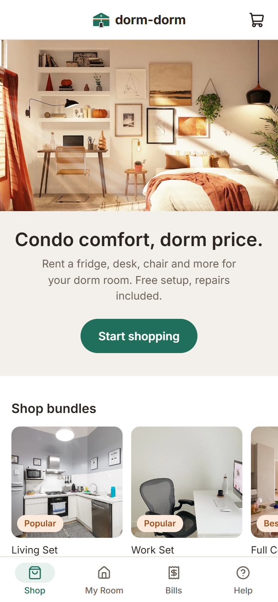
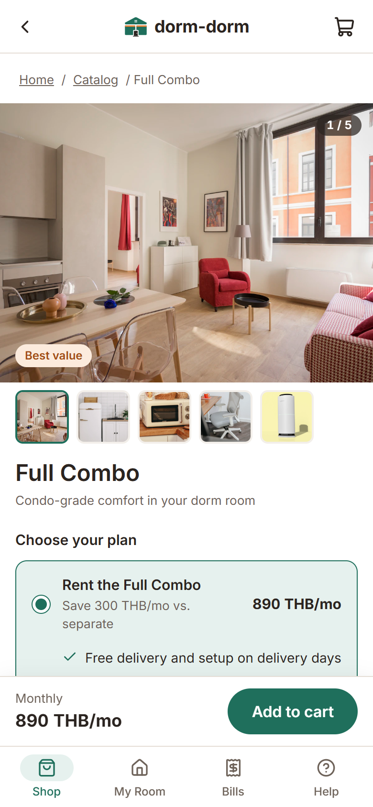
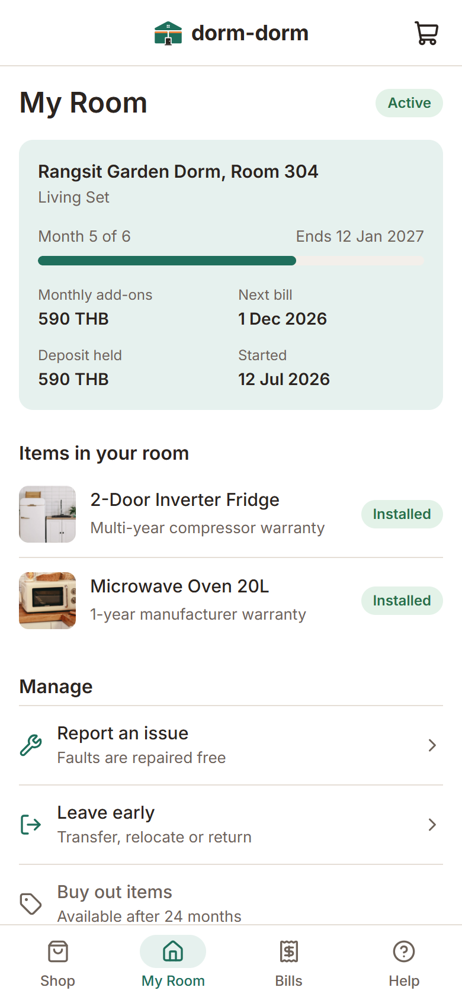
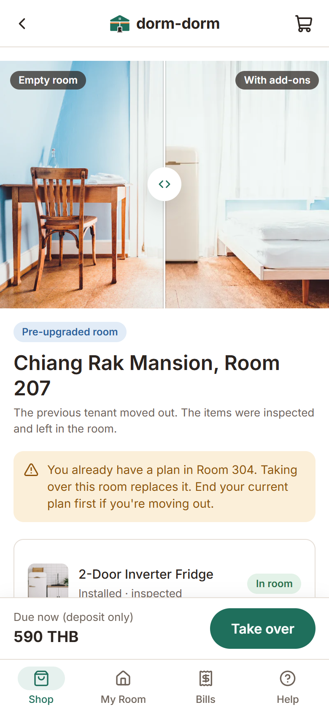
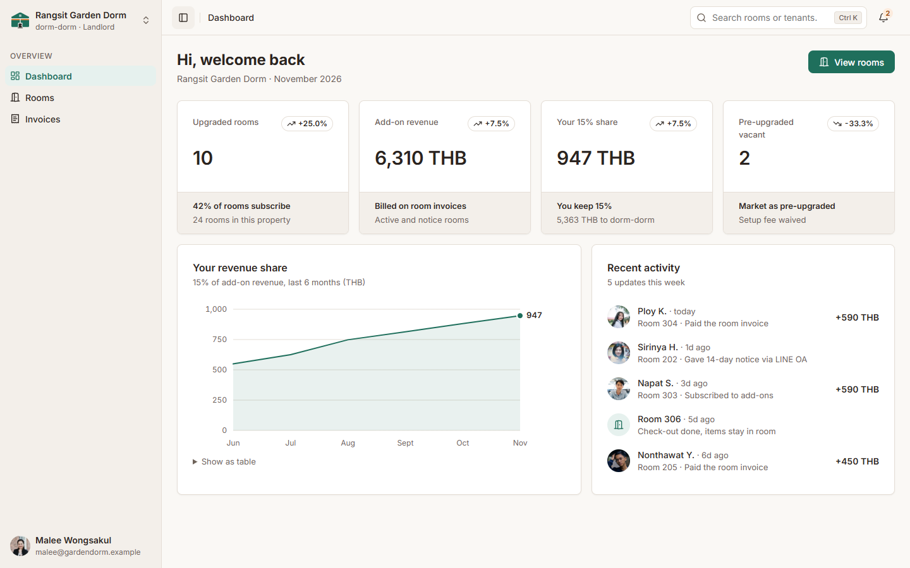
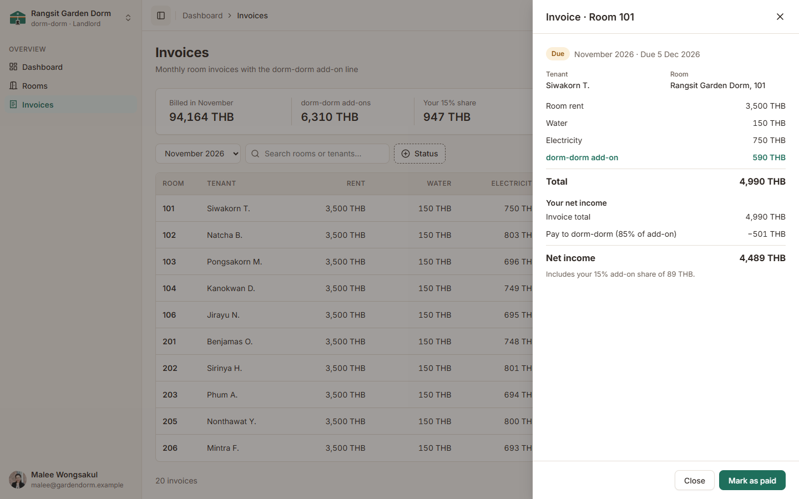
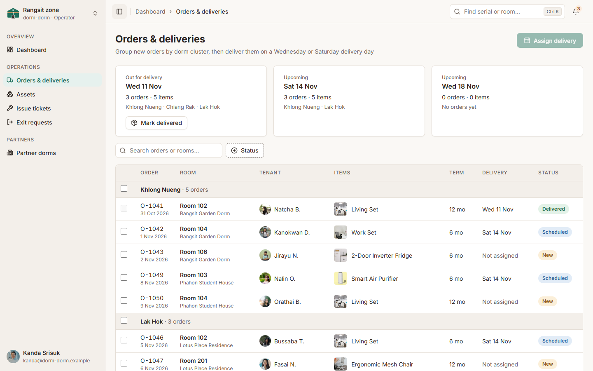

# dorm-dorm

**Condo comfort, dorm price.** A monthly subscription that lets dormitory (หอพัก) tenants rent a fridge, microwave, ergonomic chair, standing desk or air purifier for their room, with free setup and repairs included.

**[Try the live prototype →](https://pakkapolmal.github.io/dorm-dorm/)**

> A clickable UI prototype for the DES324 Entrepreneurship course. Every name, room, order and payment in it is mock data. Nothing is real, and nothing is saved.

## The idea

A student in a 3,500 THB/month dorm room usually gets a bed and not much else. Moving up to a condo costs 7,500+ THB/month plus a 22,500+ THB deposit and a 12-month lease.

dorm-dorm closes that gap. Tenants add condo-grade items to the room they already have, starting at 220 THB/month. They pay on their normal room invoice, and when they move out the items stay in the room for the next tenant.

Dorm owners are partners, not middlemen to cut out. They bill the add-on on the monthly room invoice, keep a **15% revenue share**, and can market their rooms as "pre-upgraded".

| Set | What's inside | Price |
|---|---|---|
| **Work Set** | Ergonomic chair + standing desk | 490 THB/mo |
| **Living Set** | Fridge + microwave | 590 THB/mo |
| **Full Combo** | Fridge + microwave + ergonomic chair + air purifier | 890 THB/mo |

Single items run from 220 to 450 THB/month. A dorm room plus the Full Combo comes to **4,390 THB/month**, about 40% less than the cheapest nearby condo.

## Three views, one service

The prototype opens on a role picker. Each role sees its own app.

### Tenant (mobile)

Shop sets and single items, check out, then manage the room: report a broken item, see bills, leave early (transfer, relocate or return), or buy items out after 24 months.

<table>
  <tr>
    <td></td>
    <td></td>
    <td></td>
    <td></td>
  </tr>
  <tr>
    <td align="center">Shop</td>
    <td align="center">Choose a plan</td>
    <td align="center">My Room</td>
    <td align="center">Take over a pre-upgraded room</td>
  </tr>
</table>

### Landlord (desktop)

See which rooms are upgraded, how much add-on revenue the property earns, and each month's room invoices with the landlord's net income after dorm-dorm's share.





### Operator (desktop)

The dorm-dorm team's back office: group new orders into Wednesday and Saturday deliveries, track every item in the warehouse and in rooms, handle repair tickets and process tenants leaving early.



## Things to try

- **Switch scenarios.** On the tenant's **Help** tab, the demo controls switch between a tenant at month 5 of a 6-month lease, one at month 26 who can buy items out, and a brand-new tenant with no add-ons.
- **Leave early.** As the tenant, go to *My Room → Leave early* and compare the three ways out and their fees.
- **Plan a delivery.** As the operator, tick a few new orders and press *Assign delivery*. Then press *Mark delivered* on the *Out for delivery* card: those rooms turn Active in the landlord's view too.
- **Open an invoice.** As the landlord, open any room on the *Invoices* page to see where the money goes.

## Run it locally

You need [Node.js](https://nodejs.org/) 20.19 or newer.

```bash
npm install
npm run dev
```

Then open the address it prints.

## Credits

A DES324 Entrepreneurship course project. Photos are from Unsplash and Pexels; see [docs/IMAGE_CREDITS.md](docs/IMAGE_CREDITS.md) for each photographer.
